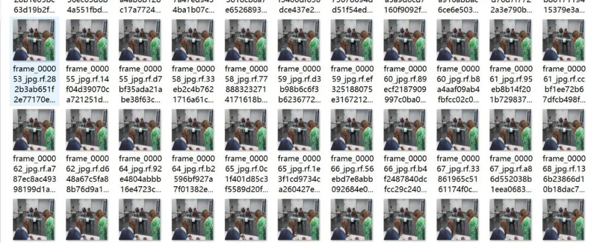
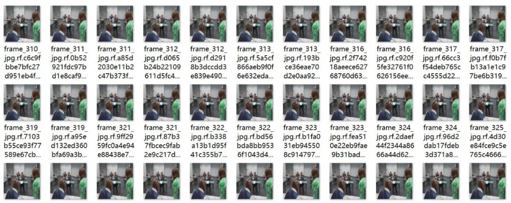
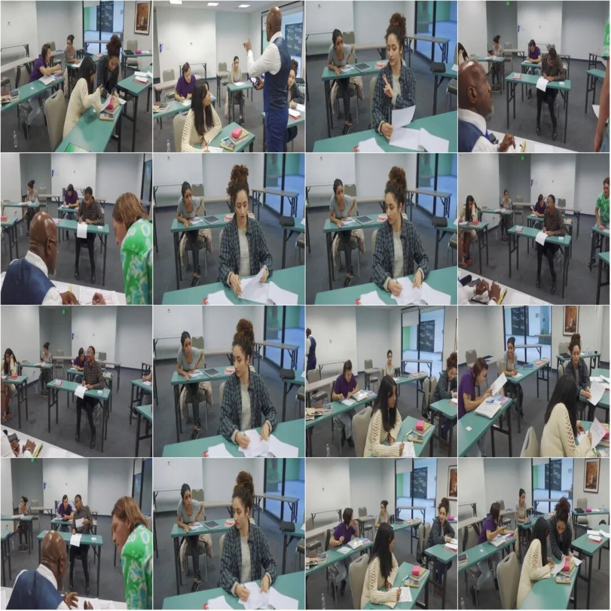
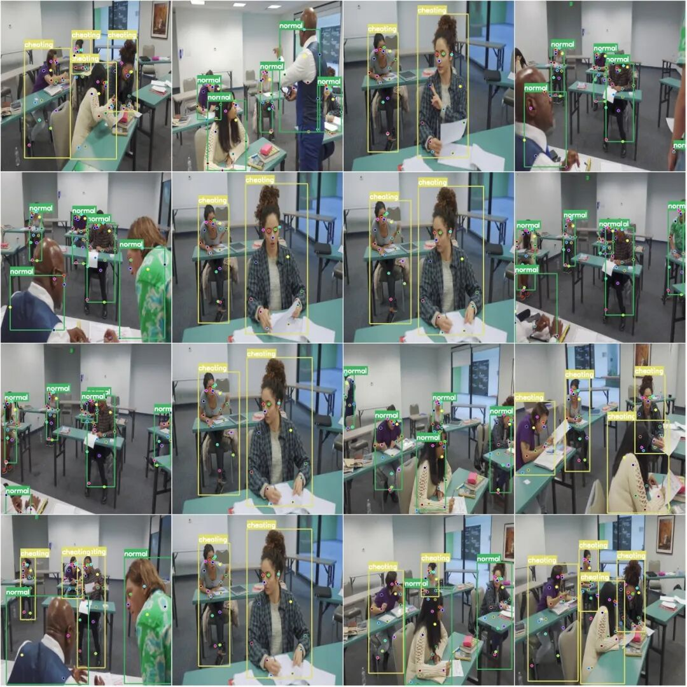

# Examination Venue Behavior Key Points Posture Estimation Detection Dataset COCO+YOLO format 1738 images 2 categories 17 key points

Dataset format: YOLO keypoint format (Note that this is not the YOLO format for object detection or segmentation, but merely includes jpg images and corresponding yolo format txt files).

Number of images (number of jpg files): 1738

Number of annotations (number of txt files): 1738

Number of training set: 1432

Number of Validation Sets: 203

Number of test sets: 103

Labeling category count: 2

Label category name: ['cheating', 'normal']

Number of key points marked: 17

Key Point Names: ["nose", "left_eye", "right_eye", "left_ear", "right_ear", "left_shoulder", "right_shoulder", "left_elbow", "right_elbow", "left_wrist", "right_wrist", "left_hip", "right_hip", "left_knee", "right_knee", "left_ankle", "right_ankle"]

Number of boxes labeled in each category:

Cheating frame count = 2932

Normal frame count = 4513

Total frame count = 7445

Image resolution: 640x640

Important Notice: The dataset has been divided into training, validation, and test sets. These can be directly used for training Yolov5-pose, Yolov8-pose, Yolov11-pose, or Yolov26-pose.

Special : This dataset does not guarantee the accuracy of the trained models or weight files.

Image Preview:

Annotation example:

Original image (pick 16 randomly):

Annotation:

## Payment

Here is a pay link on Stripe ( https://buy.stripe.com/3cs8yP7sY87d0vu9AB ). Please contact me lonlonago@foxmail.com after funding $89, and I will send you a complete data files , thank you!

